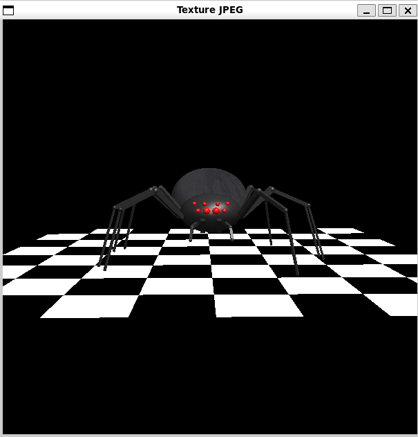

# Modélisation et Animation 3D d'une Araignée — OpenGL / C++



## Contexte

Projet réalisé en **L3 Informatique (Synthèse d'Images)** ayant pour objectif de concevoir une scène 3D interactive complète en C++ avec OpenGL (FreeGLUT) : modélisation paramétrique et hiérarchique d'une araignée articulée, double texturage, éclairage de Phong et animation temps réel.

## Points techniques clés

- **Surface paramétrique explicite** (`dessinerAbdomenParametrique`) : abdomen modélisé à partir de l'équation paramétrique d'un ellipsoïde en `GL_QUAD_STRIP` ($24 \times 24$), avec calcul analytique des normales unitaires et génération manuelle des coordonnées UV $(s, t)$ sans `glTexGen`.
- **Arbre hiérarchique** (`glPushMatrix` / `glPopMatrix`) : céphalothorax, 8 yeux, chélicères (crochets) interactifs, pédipalpes et 8 pattes articulées à 3 segments (fémur, tibia, pointe et rotules) construites par symétrie gauche/droite.
- **Double texturage OpenGL** (`glGenTextures`, `glBindTexture`) : chargement et assombrissement d'une texture JPEG (`libjpeg`) enroulée sur l'abdomen, et génération procédurale en mémoire d'un sol en damier $256 \times 256$.
- **Illumination de Phong** (`initLumiere`) : combinaison d'une source directionnelle à l'infini (`GL_LIGHT0`, $w = 0$) et d'une source ponctuelle locale zénithale (`GL_LIGHT1`, $w = 1$), avec ombrage continu de Gouraud (`GL_SMOOTH`) et `GL_NORMALIZE`.
- **Animations** : marche autonome continue en tétrapodes alternés (`glutIdleFunc`) et contrôle interactif des crochets au clavier.

## Stack technique

- **Langage** : `C++`
- **Graphismes & fenêtrage** : `OpenGL`, `GLU`, `FreeGLUT`
- **Chargement d'image** : `libjpeg`
- **Build** : `Makefile` (`g++`)

## Compilation et exécution

Sous Linux / WSL (Ubuntu / Debian) :

```bash
sudo apt update && sudo apt install -y g++ freeglut3-dev libjpeg-dev
make
./araignee
```

Pour nettoyer les fichiers générés :

```bash
make clean
```

## Contrôles interactifs

| Touche / Action | Effet |
| :--- | :--- |
| Clic gauche + souris | Orbite libre de la caméra autour de la scène |
| Flèches directionnelles | Rotation de la caméra par pas de 5° |
| `z` / `Z` | Zoom avant / Zoom arrière |
| `c` / `v` | Refermer / Écarter les crochets (chélicères) |
| `l` / `n` | Basculer le filtrage de texture (`GL_LINEAR` / `GL_NEAREST`) |
| `Échap` | Quitter l'application |

## Rapport & Auteurs

- [Rapport complet du projet (PDF)](docs/Rapport_Synthese_Images.pdf)
- **Auteurs** : Quentin Bredon & Nadji Djebailia
